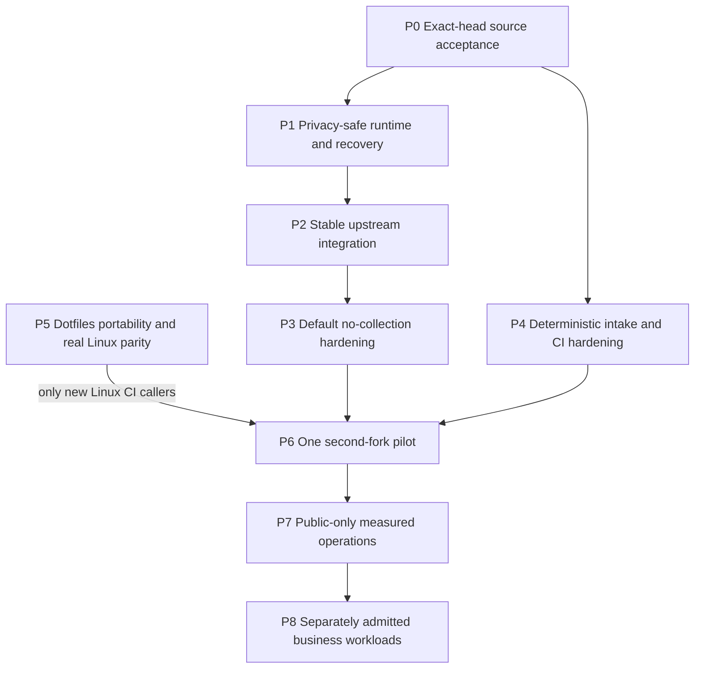

# Native agentic DevSecOps: phased execution proposal

Date: 2026-10-15. Evidence baseline: source `e8ce3a94e`.
Status: architecture synthesis and bounded task queue, not an activated fleet,
certification, claim of global optimality, or new authorization for effects.

## Ownership and existing authority

This source-owned proposal joins existing plans, not replaces them:

- [Native adoption directives](../upstream-native-adoption-2026-10-14.md) retain
  their historical version scope. Later stable releases need a new delta review.
- [Fork maintenance](../fork-maintenance.md) owns release-distance semantics;
  [the incident receipt](../upstream-feedback/2026-10-15-fork-feedback-loop.md)
  records the original audit, fixes and limitations.
- Dotfiles owns canonical policy, route admission, host provisioning and portfolio
  pointers: `docs/plans/2026-10-14-post-delivery-system-roadmap.md`, `docs/current.md`
  and `docs/current-state.v1.json` in that repository. Link by ownership, not by
  copying private policy or business context into this public repository.
- Each product owns its build, data, protocol, release and recovery contracts.
  GitHub executes checks and narrowly scoped publication. The captain integrates
  evidence and owns acceptance. Consultants advise and never widen authority.

The operator authorized iterative validated commits/merges and architect research.
This does not silently authorize new spending, credential/provider changes,
private-data egress, destructive cleanup, installations or VM/image provisioning.
Commit owned paths only. Preserve foreign staging, branches and active leases.

## Verified mechanisms and important gaps

Two disjoint Astra/high consultations used public source/history and primary
public documentation. Source mechanisms below were additionally inspected by
this captain. Peer dotfiles outcomes remain explicitly peer-reported.

| Observation | Evidence and limitation |
| --- | --- |
| Native task DAG validates ownership, running state and artifacts | `crates/jcode-plan/src/dag/ops.rs:377-410`; gate checks do not themselves run acceptance tests |
| Native build queue, schedules, status and reload exist | `crates/jcode-app-core/src/tool/selfdev/build_queue.rs`, `tool/ambient.rs`, `tool/selfdev/status.rs`; use them rather than a second supervisor |
| Spawn schema exposes model and effort | `crates/jcode-app-core/src/tool/communicate.rs:2108-2115`; no per-spawn tool allowlist is advertised there. Prompt restrictions are NOT an enforced sandbox |
| Telemetry defaults enabled without an opt-out | `crates/jcode-telemetry-core/src/lib.rs:457-488`; in-app disable emits before persistence at `531-536`. Do not use that setter as an opt-out probe |
| One read-only fork observer already exists | `scripts/fork_health.py`; stable-release containment and moving-development lag are independent. Missing release is unknown, not healthy |
| Review intake already exists in dotfiles | `scripts/github-pr-feedback.py`; no duplicate collector/controller. Root-thread metadata does not include every maintainer reply |
| Proposal validation and publication are separate | `.github/workflows/upstream-release-sync.yml`; narrow validation is not full CI, and GITHUB_TOKEN proposals do not trigger normal downstream CI |
| Current containment is bounded, not a concurrency fix | `e8ce3a94e`; two local reproductions passed, hosted macOS concurrency hang root cause remains unproven |
| Runtime build is not runtime activation | Native build `613601h3ba` and three-test task `680318q58p` passed; running `9397d2100` was not patched-runtime evidence |
| Historical architecture reference is absent | `docs/HARNESS_LOOP_ARCHITECTURE.md` is not at this HEAD; do not restore historical text as current authority |

The configured native worker cap is three, not the larger examples in design
notes. Root-only dispatch, disjoint readers, one writer per repository and a
separate substantive reviewer are sufficient here. Retire completed workers to
free slots; do not change active routes or effort after a failure.

## Dependency order



Read-only preparation and dotfiles static portability may proceed in parallel.
Runtime promotion, CI activation and fleet expansion must respect the gates.
The already-accepted privacy behavior of a current runtime must not be weakened
while waiting for later default-hardening work.

### P0. Accept the current source increment

Owner: source captain plus independent verifier. No new source edits unless a
separate reproduced-finding packet is admitted.

- Freeze candidate `e8ce3a94e6ad135c399cb795b6935d683b387b20`, PR #5 and its
  current base. Check full hosted CI `38703592592`, CodeQL and current review
  threads on that exact head. Earlier green heads are not substitutes.
- Run command set A below. Strict advisory scanning must run where cargo-audit
  is installed; a locally skipped scan is not acceptance.
- On green required checks and no blocking findings, use the approved ordinary
  merge with exact-head guard. No admin bypass, squash, force or branch deletion.
  Verify API merge SHA/state and resulting default-branch workflows.
- Rollback: withhold merge on any failure, moving head or missing evidence.
  Recurrent browser hangs get a separate reproduction-first packet, not skips.

### P1. Prove privacy-safe runtime, identity and recoverability

Owner: source captain. Allowed repository edits: none for verification/activation.
Depends on P0. Existing effective environment/marker opt-out is mandatory before
any reload. Read status without creating identities or changing configuration;
prove that replacement processes preserve the opt-out. No real-account or
provider request, no silent host changes, no opt-out setter as a probe.

Reconcile accepted SHA/tree, patched lockfile, source fingerprint, immutable build
and intended daemon/socket. Use `selfdev status`, coordinated `selfdev build`
when the artifact does not match, then native reload only after these gates.
For an accepted clean candidate, `selfdev build-reload target=tui` combines the
build/reload path; it is not permission to skip privacy or recovery checks.

Acceptance: running/current/shared-server identities, isolated runtime smoke,
`debug_socket` server state/client frame where applicable, reconnect/session
continuity, and a retained last-known-good artifact/native rollback record.
Discover actual debug commands rather than inventing a schema. Do not claim
that switching one process upgraded every daemon. Desktop remains separate;
bridge upgrades use `selfdev reload-bridge`, never a manual bridge kill.

Stop on missing opt-out, source/artifact mismatch, unexpected collection or failed
recovery. Build success alone does not authorize activation.

### P2. Integrate the selected stable release without losing fork safeguards

Owner: one approved isolated source writer, then an independent high reviewer.
Pin stable `1c7426eb1925a1167eb56011fa479ad707cc28b6` and a fresh fork base.
Manual resolution allowlist: ten conflict paths named in `fork-maintenance.md`,
plus `ci.yml` and its existing contract fixture. Other imported changes must be
from that pinned release, not unrelated branches.

Preserve sanitizer ordering, durable opt-outs, account/route behavior and
publication boundaries. Reconcile upstream `!cancelled()` quality-step contracts;
never raise ratchets, add skips or select wholesale ours/theirs to hide failures.
Run command set B, affected privacy/TUI/platform cohorts, full exact-head hosted
CI and representative runtime checks. Retain both parent ancestries.

No partial conflicted merge in a live harness checkout. Isolation must meet
current approval boundaries. Additional semantic files require readmission.
Rollback: withhold integration, preserve all original refs and artifacts.

### P3. Make the fork's default collection behavior satisfy its policy

Owner: source privacy/security writer and independent high reviewer. Depends on
P2 for the final port; its read-only characterization may prepare earlier.

Use `git diff-tree --no-commit-id --name-only -r c81735fdf` to inspect the existing
44-file privacy delta, not as blanket write authority. Do not merge its 62-commit
branch or blindly cherry-pick that delta. Freeze a minimal initial file list and
add a normal-library no-collection regression before implementation.

The historical branch contains `crates/jcode-telemetry-core/tests/no_collection.rs`;
that test is not currently at HEAD. After an admitted port, proposed acceptance
includes `cargo test --locked -p jcode-telemetry-core --test no_collection`,
`bash scripts/test_install_conversion.sh`, the existing commands in
`docs/privacy-development.md`, affected config/TUI tests and full CI.
Cover fresh and legacy homes, attempted reenable, tracking-state creation and
outbound attempts. Preserve operational local observability and unrelated tests.
A proxy interception test alone is not universal proof of zero network egress.
Withhold later activation on failure or scope expansion.

### P4. Harden existing feedback and CI, not create an autonomous controller

Owners: dotfiles captain for its existing collector/fixtures; source captain for
an independently scoped workflow/observer packet. Can prepare alongside P0-P3.
This is a queue of independent findings, not one combined hardening packet;
intake fixtures and action pinning each need their own bounded admission.

1. Prove exact-head provenance, unchanged-observation deduplication, bounded
   complete results, stale-thread revalidation and untrusted-text handling.
   Missing replies are not evidence of no maintainer requests.
2. External comments/logs may propose work only. Canonical path/symlink checks,
   scoped effects and authorization outside model text precede execution.
   Unknown enforced tool/data isolation blocks private or unattended writable
   work. Fresh sessions and folders are not security isolation.
3. Verify reported mutable action references and pin full SHAs against their
   source repositories. Preserve read-only default tokens and the clean
   publication barrier. New OIDC/deployment paths need separate admission.
4. Admit separate fixes for empty test cohorts, timeout diagnostics, stale docs
   and observer snapshot provenance only after their own reproduction and
   exact-file packet. Never bundle a new oracle with blanket gate weakening.

Source acceptance: relevant existing script contracts, actionlint and exact-head
CI. Dotfiles acceptance: its exact fixture commands and both required repository
gates. Failure leaves the observer one-shot/read-only and disables dispatch,
not review visibility. A richer snapshot must distinguish observation time and
pinned SHAs from today's moving-ref report.

### P5. Establish real host portability before new Linux CI callers

Owner: dotfiles captain, not this source session. Canonical roadmap remains there.
Peer-reported precursors: documentation commit `38e999a` and portability commit
`718a22c`, with scoped independent reviews and both 53-suite gates passing.
The latter retained permission/rollback/symlink assertions while replacing BSD
stat probes. This is not Linux acceptance or activation.

Remaining reported blockers include actual native-tool coverage and a missing
root toolchain/provisioning manifest. Peer-reported local commit `251b55d` fixes
the two BSD `sed -i` fixture call sites using the existing helper, with restricted
sed/stat fixtures, both 53-suite gates and independent review passing. These are
local fixture results, not hosted or Linux acceptance.

The owner found real `hx --health` coverage for Swift/sourcekit-lsp/xcrun. Prefer
native macOS CI first, or a separately reviewed matrix preserving Apple health
checks and independently proving its Linux subset. Never fake xcrun or skip
assertions to manufacture Linux parity. The canonical platform decision and
provisioning manifest remain dotfiles-owned; this source plan does not require
an impossible all-platform gate on Linux.

Freeze exact audited provisioning steps first. No VM start, image pull,
installation or new CI caller without the required effect approval. On an
admitted target with real dependencies, run the applicable canonical gates:

```sh
bash scripts/verify-agent-policy.sh --repo
bash scripts/verify-repo.sh
```

Use Bash 4+ and Python 3.11+ as required there. Preserve failures rather than
reclassifying absent native coverage as a static-only success. Stop on foreign
leases/diffs, uncertain effects or missing dependencies. Do not push that peer's
other local commits from this session.

### P6. Pilot one second fork

Owner: chosen product captain with source/dotfiles peer review. Requires one
accepted source cycle, P3 privacy and recoverability evidence; P5 real parity is
required before adding Linux CI callers. Do not make an existing safe caller
need a new environment solely because this proposal exists.

Select one fork explicitly. Firefox's four missing stable commits and Herdr's
20 were observations, not approved update targets or current guarantees.
Herdr additionally needs its own `just check`, Zig 0.15.2 and signing-hermetic
fixtures. Never substitute Jcode tests or ignore its contribution policy.

Before any writes, freeze product paths, exact published release/base, native
acceptance command, tooling and recovery environment. Unknown commands stay
unadmitted until inspection. Prove one accepted maintenance and recovery cycle
with an observed isolated restore/reconnect receipt. Retaining an artifact or
rollback pointer demonstrates readiness, not successful recovery.
Failure leaves workflows/settings untouched; no automatic fleet-wide rollout.

### P7-P8. Measure public operations, then admit business workloads separately

Proposed public pilot window: ten comparable low-risk tasks or two weeks,
whichever comes first. This is an experiment bound, not a standards mandate or
proof of general superiority. Scale one repository at a time only with complete
receipts, exact-head acceptance, no unresolved critical security or boundary blocker and
improving operator minutes for comparable accepted tasks. A small sample is
only directional. No quota-filling tasks or automatic paid overflow.

Before private business work, approve a record naming data/repositories, existing
identity, admitted route/retention, allowed effects, review and recovery owners.
Enforce context/memory/cache/log/artifact separation and least privilege. Unknown
content stays private. Credentials never enter prompts. Cross-business transfer
requires a reviewed minimal artifact; private implementation stays out of public
source docs. Retain protected backups and demonstrate restore and application rollback before business writes.
Git rollback does not undo a database migration.

## Morning durable-specialist continuation, 09:38 UTC

The operator explicitly renewed coordinated source/dotfiles implementation,
planning and documentation on this date. This adds bounded source packets, not
permission to bypass P1-P3 activation or any installation, credential/provider,
publication, destructive or private-egress gate. Stop and leave recoverable
state by 12:00 UTC. One leased source writer and independent high review own
source acceptance; dotfiles owns project/tool profiles and host policy.

### Current evidence, not historical completion

- Post-merge CI `38708675955`, CodeQL `38708675838`, Workflow Lint `38708676113`
  and read-only Fork health `38711535778` are successful for accepted merge
  `d2a6737885074b143f211b3fd61dd83a5a050cc3`. Stop polling these terminal runs.
- At clean source `8cda97ac3`, historical Pi fix `99e13e2f9` is not an ancestor.
  Its `durable_pi_consumer.rs` and tests are absent. Historical component results
  cannot establish current C1-C9 acceptance. Generic durable swarm JSON state is
  not a consumed Pi executor.
- Native session tool filtering has dispatch-time validation in
  `agent/turn_execution.rs:1117-1173`, not just prompt advice. Public swarm spawn
  exposes model/effort but no per-worker tool-envelope control. SDK overrides and
  arbitrary shell access require their own trust analysis. No filesystem,
  credential or network sandbox is established by a tool-name allowlist.
- Four unchanged size/error ratchets and 17 automation tests passed at 09:35;
  coordinated offline `jcode-plan` tests passed all 78 tests. These are a clean
  baseline, not future candidate acceptance or runtime evidence.

### Bounded phases and owners

1. **Existing-owner safety prerequisite, source.** Astra/high source inspection
   identified mutation admission that conflates corrupt/unreadable JSON with
   missing state and does not validate persisted key/action/session ownership.
   First writer scope is only `server/swarm_mutation_state.rs` and its existing
   test file under app-core. Reproduce strict missing/present/error admission,
   reject mismatches before stale-state handling or a waiter/execution grant,
   preserve evidence, and retain deliberate valid control retries. Use the
   existing lock and caller seam. This is a partial C8 prerequisite, not Pi
   execution, full handler immutability or exactly-once external effects.
   Accepted locally as `920ad52b0` after 220 captain tests, unchanged ratchets,
   independent exact-byte high review and build-only provenance. The
   [handoff receipt](../upstream-feedback/2026-10-15-handoff.md) records the
   rejected candidates, serialization regression and remaining runtime holds.
2. **Frozen binding and durable lifecycle, source.** After that accepted packet,
   inventory and admit one existing-owner seam at a time: immutable payload and
   acceptance identity, checked ownership/persistence, ACK/result reconciliation,
   cancellation and cumulative deadlines/budgets. Historical types are reference
   material, not a wholesale branch import or authenticated grant.
3. **Consumed no-tools public/synthetic Pi attempt, source.** Independently prove
   C1 same-payload lost-ACK deduplication, C2 changed-packet rejection, C3 safe-read
   crash recovery, C4 bounded nonterminal aborted-stream reissue, C5 result
   redelivery without reexecution, C6 cancellation without resurrection, C7
   policy/tool/digest/bound checks across restart, C8 explicit ownership/corruption
   failure, and C9 malicious-fixture effect denial. All remain acceptance targets.
   No-tools flags are not an OS sandbox. Do not promote fixture success to live
   immutable-daemon recovery or full network isolation.
4. **Persistent identity, on-demand specialization, dotfiles.** Start with a
   verified existing review role and eligible evidence packet. Add one concrete
   project/tool profile after a proved execution envelope, not one resident
   process per project. Ghidra/REA roles initially interpret supplied sanitized
   evidence, with no implied tool install, project access or shell authority.
   Share minimal acceptance/evidence pointers, not private business contents.
5. **Measured competency/cost expansion, joint gate.** Deterministic admission
   comes first. Optional classifiers may rank only a closed admitted candidate
   set or abstain, never authorize effects or choose an unadmitted route. Freeze
   each attempt's route/effort/tools; evaluate accepted quality, retries, cache
   usage, latency and review/operator time. Add profiles one project/task class
   at a time only when measured benefits exceed coordination cost. No speculative
   router, extra supervisor, polling fleet or automatic paid fallback.

Each implementation gets strict red-before-green where applicable, nonzero
focused test selection, unchanged ratchets, independent substantive review and a
captain-owned commit. Do not widen a failed packet into the next phase. The
initial mutation-state packet excludes write-error/fsync redesign, schema changes,
new protocol fields, shared storage rewrites and Pi transport wiring.

## Packet contract and operating limits

Use native DAG dependencies/artifacts where appropriate, existing workers,
`todo`, schedules and coordinated selfdev tooling. A DAG completion validates
structure, not test truth. No separate bot, universal repair framework, polling
daemon, policy mirror, router or second fork observer is justified here.

Each admitted packet names owner/lease, frozen model+effort, permitted files,
observed behavior and desired delta, exact validation, deadline/attempt budget,
privacy/effect authority, independent review, rollback and what was not checked.
Default proposed repair cap: two implementation attempts/20 minutes; in all cases
stop no later than three failed validations, or earlier when evidence/plateau
requires escalation. Preserve a local incremental patch and exact receipt.
Commit/publish/merge only within current operator authorization and after gates.
A failure closes treatment; no hidden fallback, automatic successor or replay.

## Concrete acceptance command sets

A, existing source contracts (hosted strict audit is additionally mandatory):

```sh
python3 scripts/test_fork_health.py
python3 scripts/test_upstream_release_sync.py
python3 scripts/test_security_preflight.py
actionlint .github/workflows/ci.yml
```

B, after the pinned stable merge, not before its new fixture exists:

```sh
git diff --check
python3 tests/test_ci_workflow_guards.py
python3 scripts/test_upstream_release_sync.py
cargo metadata --locked --format-version 1 > /dev/null
cargo check --locked -p jcode --bin jcode
cargo test --locked -p jcode-config-types
cargo fmt --all -- --check
```

These are necessary narrow gates, not substitutes for full hosted tests, strict
security auditing, ratchets, independent review or affected platform/runtime
checks. Run cargo through the applicable project/native compile-lock workflow.

## Standards and economics: measured evidence, no compliance badge

The research consultant checked five primary documents on 2026-10-15 using
Jcode-native webfetch (six requests including one 404). The captain inspected
source claims above; no private workload, billing entitlement or enforcement
assessment was performed.

- [NIST SSDF](https://csrc.nist.gov/Projects/ssdf): tailor PO/PS/PW/RV practices
  to risk, cost and feasibility, not a universal checklist.
- [GitHub hardening](https://docs.github.com/en/actions/security-for-github-actions/security-guides/security-hardening-for-github-actions):
  minimum token permissions, verified SHA pins, scoped elevation, untrusted-code
  isolation, approved OIDC where applicable. Redaction is not a guaranteed
  security boundary; SHA pins still require update/advisory tracking.
- [Workflow dependency lockfiles](https://docs.github.com/en/actions/concepts/security/workflow-dependency-lockfiles):
  `actions.lock` is public preview and requires an extension; defer installation
  or adoption here. Full-SHA pins are not complete transitive dependency locking.
- [SLSA 1.2](https://slsa.dev/spec/v1.2/): source/build provenance production,
  distribution and verification are distinct. Hosted CI alone proves no level.
  Before distribution verify digest and expected source/workflow against trusted
  builder provenance. Retain the application's resolved-component SBOM through an
  existing supported path; runner SBOM is not application SBOM or vulnerability clearance.
- [OWASP agent security](https://cheatsheetseries.owasp.org/cheatsheets/AI_Agent_Security_Cheat_Sheet.html):
  untrusted external data, bounded loops, scoped authority and adversarial tests.
  Illustrative regexes are not robust isolation or authorization.

Proposed vulnerability response targets, not standards requirements: immediate
containment/escalation for active exploitation or exposed secrets, decision within
24 hours, critical remediation 72 hours, high seven days, medium 30 days. Tailor
to exposure/capacity; exceptions need owner, scope, rationale, compensating control,
expiry at most 14 days and recheck. Never silently weaken an existing strict gate.

Measure attempts/accepted/reopened fixes, all retries and review effort, operator
interventions/minutes, elapsed time, actual model usage, runner/storage/billing.
Cost per accepted task includes failed attempts. Zero accepted tasks means an
undefined ratio. Cash, subscription allocation, marginal charges and operator
minutes stay separate; unknown cost stays unknown. Free public runners are not
free inference or storage. Preserve admitted interactive reserve and budget gates.

## Decisions that block later promotion

1. Exact no-collection/private-data acceptance boundary and whether default
   collection removal blocks stable runtime promotion. Existing effective opt-out
   is mandatory before any proposed reload regardless of that decision.
2. Selected second fork and authorized disposable/toolchain environment.
3. First business/data category, isolation/egress/retention and recovery objectives.
   Until admitted, the pilot remains public-only.
4. Operator-time/capacity budget and the minimum useful same-class improvement.
   Until specified, use bounded measurement and no paid expansion.

Stop on leaks, unauthorized effects, weakened oracles, missing review, moving
heads, foreign leases, missing native dependencies, quota/cap failure or failed
recovery. Return evidence and request scoped readmission rather than broadening
execution. This proposal does not claim all forks synchronized or all gaps fixed.
