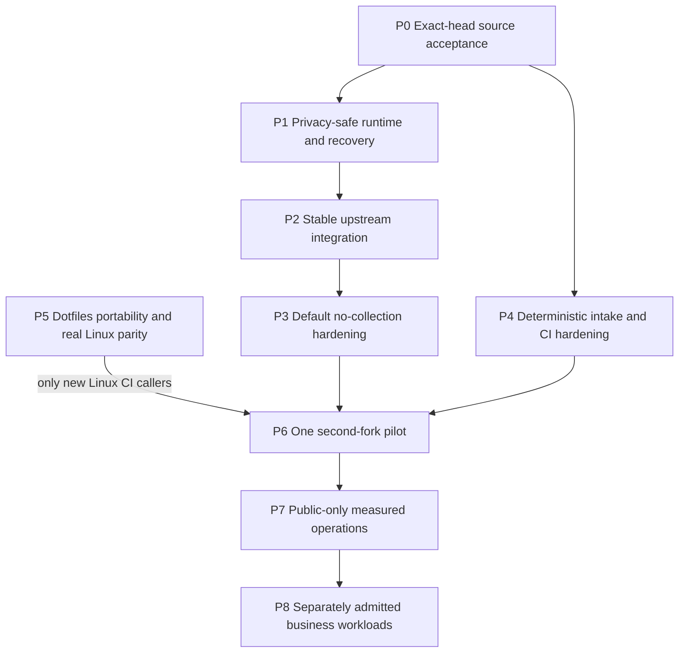
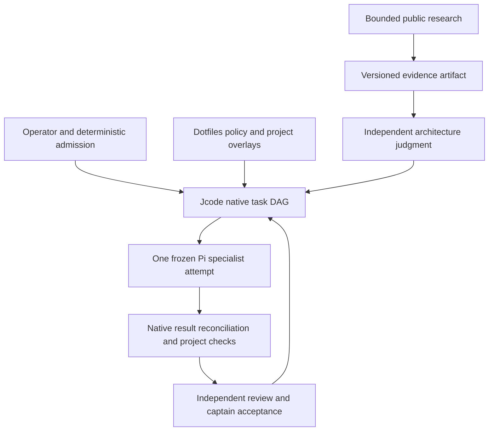

# Native agentic DevSecOps: phased execution proposal

Date: 2026-10-15. Evidence baseline: source `e8ce3a94e`.
Status: architecture synthesis and bounded task queue, not an activated fleet,
certification, claim of global optimality, or new authorization for effects.

The [22:00 UTC continuation](#coordinated-outer-loop-and-inner-loop-continuation-2200-utc)
adds the renewed outer-Jcode/inner-Pi planning mandate and later evidence at source
`ffed15383`. It extends this proposal rather than creating another roadmap.

## Ownership and existing authority

This source-owned proposal joins existing plans, not replaces them:

- [Native adoption directives](../upstream-native-adoption-2026-10-14.md) retain
  their historical version scope. Later stable releases need a new delta review.
- [Fork maintenance](../fork-maintenance.md) owns release-distance semantics;
  [the incident receipt](../upstream-feedback/2026-10-15-fork-feedback-loop.md)
  records the original audit, fixes and limitations.
- Dotfiles owns canonical policy, route admission, host provisioning and portfolio
  pointers: `docs/plans/2026-10-14-post-delivery-system-roadmap.md`, `docs/current.md`
  and `docs/current-state.v1.json` in that repository. Link by ownership, not by
  copying private policy or business context into this public repository.
- Each product owns its build, data, protocol, release and recovery contracts.
  GitHub executes checks and narrowly scoped publication. The captain integrates
  evidence and owns acceptance. Consultants advise and never widen authority.

The operator authorized iterative validated commits/merges and architect research.
This does not silently authorize new spending, credential/provider changes,
private-data egress, destructive cleanup, installations or VM/image provisioning.
Commit owned paths only. Preserve foreign staging, branches and active leases.

## Verified mechanisms and important gaps

Two disjoint Astra/high consultations used public source/history and primary
public documentation. Source mechanisms below were additionally inspected by
this captain. Peer dotfiles outcomes remain explicitly peer-reported.

| Observation | Evidence and limitation |
| --- | --- |
| Native task DAG validates ownership, running state and artifacts | `crates/jcode-plan/src/dag/ops.rs:377-410`; gate checks do not themselves run acceptance tests |
| Native build queue, schedules, status and reload exist | `crates/jcode-app-core/src/tool/selfdev/build_queue.rs`, `tool/ambient.rs`, `tool/selfdev/status.rs`; use them rather than a second supervisor |
| Spawn schema exposes model and effort | `crates/jcode-app-core/src/tool/communicate.rs:2108-2115`; no per-spawn tool allowlist is advertised there. Prompt restrictions are NOT an enforced sandbox |
| Telemetry defaults enabled without an opt-out | `crates/jcode-telemetry-core/src/lib.rs:457-488`; in-app disable emits before persistence at `531-536`. Do not use that setter as an opt-out probe |
| One read-only fork observer already exists | `scripts/fork_health.py`; stable-release containment and moving-development lag are independent. Missing release is unknown, not healthy |
| Review intake already exists in dotfiles | `scripts/github-pr-feedback.py`; no duplicate collector/controller. Root-thread metadata does not include every maintainer reply |
| Proposal validation and publication are separate | `.github/workflows/upstream-release-sync.yml`; narrow validation is not full CI, and GITHUB_TOKEN proposals do not trigger normal downstream CI |
| Current containment is bounded, not a concurrency fix | `e8ce3a94e`; two local reproductions passed, hosted macOS concurrency hang root cause remains unproven |
| Runtime build is not runtime activation | Native build `613601h3ba` and three-test task `680318q58p` passed; running `9397d2100` was not patched-runtime evidence |
| Historical architecture reference is absent | `docs/HARNESS_LOOP_ARCHITECTURE.md` is not at this HEAD; do not restore historical text as current authority |

The configured native worker cap is three, not the larger examples in design
notes. Root-only dispatch, disjoint readers, one writer per repository and a
separate substantive reviewer are sufficient here. Retire completed workers to
free slots; do not change active routes or effort after a failure.

## Dependency order



Read-only preparation and dotfiles static portability may proceed in parallel.
Runtime promotion, CI activation and fleet expansion must respect the gates.
The already-accepted privacy behavior of a current runtime must not be weakened
while waiting for later default-hardening work.

### P0. Accept the current source increment

Owner: source captain plus independent verifier. No new source edits unless a
separate reproduced-finding packet is admitted.

- Freeze candidate `e8ce3a94e6ad135c399cb795b6935d683b387b20`, PR #5 and its
  current base. Check full hosted CI `38703592592`, CodeQL and current review
  threads on that exact head. Earlier green heads are not substitutes.
- Run command set A below. Strict advisory scanning must run where cargo-audit
  is installed; a locally skipped scan is not acceptance.
- On green required checks and no blocking findings, use the approved ordinary
  merge with exact-head guard. No admin bypass, squash, force or branch deletion.
  Verify API merge SHA/state and resulting default-branch workflows.
- Rollback: withhold merge on any failure, moving head or missing evidence.
  Recurrent browser hangs get a separate reproduction-first packet, not skips.

### P1. Prove privacy-safe runtime, identity and recoverability

Owner: source captain. Allowed repository edits: none for verification/activation.
Depends on P0. Existing effective environment/marker opt-out is mandatory before
any reload. Read status without creating identities or changing configuration;
prove that replacement processes preserve the opt-out. No real-account or
provider request, no silent host changes, no opt-out setter as a probe.

Reconcile accepted SHA/tree, patched lockfile, source fingerprint, immutable build
and intended daemon/socket. Use `selfdev status`, coordinated `selfdev build`
when the artifact does not match, then native reload only after these gates.
For an accepted clean candidate, `selfdev build-reload target=tui` combines the
build/reload path; it is not permission to skip privacy or recovery checks.

Acceptance: running/current/shared-server identities, isolated runtime smoke,
`debug_socket` server state/client frame where applicable, reconnect/session
continuity, and a retained last-known-good artifact/native rollback record.
Discover actual debug commands rather than inventing a schema. Do not claim
that switching one process upgraded every daemon. Desktop remains separate;
bridge upgrades use `selfdev reload-bridge`, never a manual bridge kill.

Stop on missing opt-out, source/artifact mismatch, unexpected collection or failed
recovery. Build success alone does not authorize activation.

### P2. Integrate the selected stable release without losing fork safeguards

Owner: one approved isolated source writer, then an independent high reviewer.
Pin stable `1c7426eb1925a1167eb56011fa479ad707cc28b6` and a fresh fork base.
Manual resolution allowlist: ten conflict paths named in `fork-maintenance.md`,
plus `ci.yml` and its existing contract fixture. Other imported changes must be
from that pinned release, not unrelated branches.

Preserve sanitizer ordering, durable opt-outs, account/route behavior and
publication boundaries. Reconcile upstream `!cancelled()` quality-step contracts;
never raise ratchets, add skips or select wholesale ours/theirs to hide failures.
Run command set B, affected privacy/TUI/platform cohorts, full exact-head hosted
CI and representative runtime checks. Retain both parent ancestries.

No partial conflicted merge in a live harness checkout. Isolation must meet
current approval boundaries. Additional semantic files require readmission.
Rollback: withhold integration, preserve all original refs and artifacts.

### P3. Make the fork's default collection behavior satisfy its policy

Owner: source privacy/security writer and independent high reviewer. Depends on
P2 for the final port; its read-only characterization may prepare earlier.

Use `git diff-tree --no-commit-id --name-only -r c81735fdf` to inspect the existing
44-file privacy delta, not as blanket write authority. Do not merge its 62-commit
branch or blindly cherry-pick that delta. Freeze a minimal initial file list and
add a normal-library no-collection regression before implementation.

The historical branch contains `crates/jcode-telemetry-core/tests/no_collection.rs`;
that test is not currently at HEAD. After an admitted port, proposed acceptance
includes `cargo test --locked -p jcode-telemetry-core --test no_collection`,
`bash scripts/test_install_conversion.sh`, the existing commands in
`docs/privacy-development.md`, affected config/TUI tests and full CI.
Cover fresh and legacy homes, attempted reenable, tracking-state creation and
outbound attempts. Preserve operational local observability and unrelated tests.
A proxy interception test alone is not universal proof of zero network egress.
Withhold later activation on failure or scope expansion.

### P4. Harden existing feedback and CI, not create an autonomous controller

Owners: dotfiles captain for its existing collector/fixtures; source captain for
an independently scoped workflow/observer packet. Can prepare alongside P0-P3.
This is a queue of independent findings, not one combined hardening packet;
intake fixtures and action pinning each need their own bounded admission.

1. Prove exact-head provenance, unchanged-observation deduplication, bounded
   complete results, stale-thread revalidation and untrusted-text handling.
   Missing replies are not evidence of no maintainer requests.
2. External comments/logs may propose work only. Canonical path/symlink checks,
   scoped effects and authorization outside model text precede execution.
   Unknown enforced tool/data isolation blocks private or unattended writable
   work. Fresh sessions and folders are not security isolation.
3. Verify reported mutable action references and pin full SHAs against their
   source repositories. Preserve read-only default tokens and the clean
   publication barrier. New OIDC/deployment paths need separate admission.
4. Admit separate fixes for empty test cohorts, timeout diagnostics, stale docs
   and observer snapshot provenance only after their own reproduction and
   exact-file packet. Never bundle a new oracle with blanket gate weakening.

Source acceptance: relevant existing script contracts, actionlint and exact-head
CI. Dotfiles acceptance: its exact fixture commands and both required repository
gates. Failure leaves the observer one-shot/read-only and disables dispatch,
not review visibility. A richer snapshot must distinguish observation time and
pinned SHAs from today's moving-ref report.

### P5. Establish real host portability before new Linux CI callers

Owner: dotfiles captain, not this source session. Canonical roadmap remains there.
Peer-reported precursors: documentation commit `38e999a` and portability commit
`718a22c`, with scoped independent reviews and both 53-suite gates passing.
The latter retained permission/rollback/symlink assertions while replacing BSD
stat probes. This is not Linux acceptance or activation.

Remaining reported blockers include actual native-tool coverage and a missing
root toolchain/provisioning manifest. Peer-reported local commit `251b55d` fixes
the two BSD `sed -i` fixture call sites using the existing helper, with restricted
sed/stat fixtures, both 53-suite gates and independent review passing. These are
local fixture results, not hosted or Linux acceptance.

The owner found real `hx --health` coverage for Swift/sourcekit-lsp/xcrun. Prefer
native macOS CI first, or a separately reviewed matrix preserving Apple health
checks and independently proving its Linux subset. Never fake xcrun or skip
assertions to manufacture Linux parity. The canonical platform decision and
provisioning manifest remain dotfiles-owned; this source plan does not require
an impossible all-platform gate on Linux.

Freeze exact audited provisioning steps first. No VM start, image pull,
installation or new CI caller without the required effect approval. On an
admitted target with real dependencies, run the applicable canonical gates:

```sh
bash scripts/verify-agent-policy.sh --repo
bash scripts/verify-repo.sh
```

Use Bash 4+ and Python 3.11+ as required there. Preserve failures rather than
reclassifying absent native coverage as a static-only success. Stop on foreign
leases/diffs, uncertain effects or missing dependencies. Do not push that peer's
other local commits from this session.

### P6. Pilot one second fork

Owner: chosen product captain with source/dotfiles peer review. Requires one
accepted source cycle, P3 privacy and recoverability evidence; P5 real parity is
required before adding Linux CI callers. Do not make an existing safe caller
need a new environment solely because this proposal exists.

Select one fork explicitly. Firefox's four missing stable commits and Herdr's
20 were observations, not approved update targets or current guarantees.
Herdr additionally needs its own `just check`, Zig 0.15.2 and signing-hermetic
fixtures. Never substitute Jcode tests or ignore its contribution policy.

Before any writes, freeze product paths, exact published release/base, native
acceptance command, tooling and recovery environment. Unknown commands stay
unadmitted until inspection. Prove one accepted maintenance and recovery cycle
with an observed isolated restore/reconnect receipt. Retaining an artifact or
rollback pointer demonstrates readiness, not successful recovery.
Failure leaves workflows/settings untouched; no automatic fleet-wide rollout.

### P7-P8. Measure public operations, then admit business workloads separately

Proposed public pilot window: ten comparable low-risk tasks or two weeks,
whichever comes first. This is an experiment bound, not a standards mandate or
proof of general superiority. Scale one repository at a time only with complete
receipts, exact-head acceptance, no unresolved critical security or boundary blocker and
improving operator minutes for comparable accepted tasks. A small sample is
only directional. No quota-filling tasks or automatic paid overflow.

Before private business work, approve a record naming data/repositories, existing
identity, admitted route/retention, allowed effects, review and recovery owners.
Enforce context/memory/cache/log/artifact separation and least privilege. Unknown
content stays private. Credentials never enter prompts. Cross-business transfer
requires a reviewed minimal artifact; private implementation stays out of public
source docs. Retain protected backups and demonstrate restore and application rollback before business writes.
Git rollback does not undo a database migration.

## Morning durable-specialist continuation, 09:38 UTC

The operator explicitly renewed coordinated source/dotfiles implementation,
planning and documentation on this date. This adds bounded source packets, not
permission to bypass P1-P3 activation or any installation, credential/provider,
publication, destructive or private-egress gate. Stop and leave recoverable
state by 12:00 UTC. One leased source writer and independent high review own
source acceptance; dotfiles owns project/tool profiles and host policy.

### Current evidence, not historical completion

- Post-merge CI `38708675955`, CodeQL `38708675838`, Workflow Lint `38708676113`
  and read-only Fork health `38711535778` are successful for accepted merge
  `d2a6737885074b143f211b3fd61dd83a5a050cc3`. Stop polling these terminal runs.
- At clean source `8cda97ac3`, historical Pi fix `99e13e2f9` is not an ancestor.
  Its `durable_pi_consumer.rs` and tests are absent. Historical component results
  cannot establish current C1-C9 acceptance. Generic durable swarm JSON state is
  not a consumed Pi executor.
- Native session tool filtering has dispatch-time validation in
  `agent/turn_execution.rs:1117-1173`, not just prompt advice. Public swarm spawn
  exposes model/effort but no per-worker tool-envelope control. SDK overrides and
  arbitrary shell access require their own trust analysis. No filesystem,
  credential or network sandbox is established by a tool-name allowlist.
- Four unchanged size/error ratchets and 17 automation tests passed at 09:35;
  coordinated offline `jcode-plan` tests passed all 78 tests. These are a clean
  baseline, not future candidate acceptance or runtime evidence.

### Bounded phases and owners

1. **Existing-owner safety prerequisite, source.** Astra/high source inspection
   identified mutation admission that conflates corrupt/unreadable JSON with
   missing state and does not validate persisted key/action/session ownership.
   First writer scope is only `server/swarm_mutation_state.rs` and its existing
   test file under app-core. Reproduce strict missing/present/error admission,
   reject mismatches before stale-state handling or a waiter/execution grant,
   preserve evidence, and retain deliberate valid control retries. Use the
   existing lock and caller seam. This is a partial C8 prerequisite, not Pi
   execution, full handler immutability or exactly-once external effects.
   Accepted locally as `920ad52b0` after 220 captain tests, unchanged ratchets,
   independent exact-byte high review and build-only provenance. The
   [handoff receipt](../upstream-feedback/2026-10-15-handoff.md) records the
   rejected candidates, serialization regression and remaining runtime holds.
2. **Frozen binding and durable lifecycle, source.** After that accepted packet,
   inventory and admit one existing-owner seam at a time: immutable payload and
   acceptance identity, checked ownership/persistence, ACK/result reconciliation,
   cancellation and cumulative deadlines/budgets. Historical types are reference
   material, not a wholesale branch import or authenticated grant.
3. **Consumed no-tools public/synthetic Pi attempt, source.** Independently prove
   C1 same-payload lost-ACK deduplication, C2 changed-packet rejection, C3 safe-read
   crash recovery, C4 bounded nonterminal aborted-stream reissue, C5 result
   redelivery without reexecution, C6 cancellation without resurrection, C7
   policy/tool/digest/bound checks across restart, C8 explicit ownership/corruption
   failure, and C9 malicious-fixture effect denial. All remain acceptance targets.
   No-tools flags are not an OS sandbox. Do not promote fixture success to live
   immutable-daemon recovery or full network isolation.
4. **Persistent identity, on-demand specialization, dotfiles.** Start with a
   verified existing review role and eligible evidence packet. Add one concrete
   project/tool profile after a proved execution envelope, not one resident
   process per project. Ghidra/REA roles initially interpret supplied sanitized
   evidence, with no implied tool install, project access or shell authority.
   Share minimal acceptance/evidence pointers, not private business contents.
5. **Measured competency/cost expansion, joint gate.** Deterministic admission
   comes first. Optional classifiers may rank only a closed admitted candidate
   set or abstain, never authorize effects or choose an unadmitted route. Freeze
   each attempt's route/effort/tools; evaluate accepted quality, retries, cache
   usage, latency and review/operator time. Add profiles one project/task class
   at a time only when measured benefits exceed coordination cost. No speculative
   router, extra supervisor, polling fleet or automatic paid fallback.

Each implementation gets strict red-before-green where applicable, nonzero
focused test selection, unchanged ratchets, independent substantive review and a
captain-owned commit. Do not widen a failed packet into the next phase. The
initial mutation-state packet excludes write-error/fsync redesign, schema changes,
new protocol fields, shared storage rewrites and Pi transport wiring.

## Packet contract and operating limits

Use native DAG dependencies/artifacts where appropriate, existing workers,
`todo`, schedules and coordinated selfdev tooling. A DAG completion validates
structure, not test truth. No separate bot, universal repair framework, polling
daemon, policy mirror, router or second fork observer is justified here.

Each admitted packet names owner/lease, frozen model+effort, permitted files,
observed behavior and desired delta, exact validation, deadline/attempt budget,
privacy/effect authority, independent review, rollback and what was not checked.
Default proposed repair cap: two implementation attempts/20 minutes; in all cases
stop no later than three failed validations, or earlier when evidence/plateau
requires escalation. Preserve a local incremental patch and exact receipt.
Commit/publish/merge only within current operator authorization and after gates.
A failure closes treatment; no hidden fallback, automatic successor or replay.

## Concrete acceptance command sets

A, existing source contracts (hosted strict audit is additionally mandatory):

```sh
python3 scripts/test_fork_health.py
python3 scripts/test_upstream_release_sync.py
python3 scripts/test_security_preflight.py
actionlint .github/workflows/ci.yml
```

B, after the pinned stable merge, not before its new fixture exists:

```sh
git diff --check
python3 tests/test_ci_workflow_guards.py
python3 scripts/test_upstream_release_sync.py
cargo metadata --locked --format-version 1 > /dev/null
cargo check --locked -p jcode --bin jcode
cargo test --locked -p jcode-config-types
cargo fmt --all -- --check
```

These are necessary narrow gates, not substitutes for full hosted tests, strict
security auditing, ratchets, independent review or affected platform/runtime
checks. Run cargo through the applicable project/native compile-lock workflow.

## Standards and economics: measured evidence, no compliance badge

The research consultant checked five primary documents on 2026-10-15 using
Jcode-native webfetch (six requests including one 404). The captain inspected
source claims above; no private workload, billing entitlement or enforcement
assessment was performed.

- [NIST SSDF](https://csrc.nist.gov/Projects/ssdf): tailor PO/PS/PW/RV practices
  to risk, cost and feasibility, not a universal checklist.
- [GitHub hardening](https://docs.github.com/en/actions/security-for-github-actions/security-guides/security-hardening-for-github-actions):
  minimum token permissions, verified SHA pins, scoped elevation, untrusted-code
  isolation, approved OIDC where applicable. Redaction is not a guaranteed
  security boundary; SHA pins still require update/advisory tracking.
- [Workflow dependency lockfiles](https://docs.github.com/en/actions/concepts/security/workflow-dependency-lockfiles):
  `actions.lock` is public preview and requires an extension; defer installation
  or adoption here. Full-SHA pins are not complete transitive dependency locking.
- [SLSA 1.2](https://slsa.dev/spec/v1.2/): source/build provenance production,
  distribution and verification are distinct. Hosted CI alone proves no level.
  Before distribution verify digest and expected source/workflow against trusted
  builder provenance. Retain the application's resolved-component SBOM through an
  existing supported path; runner SBOM is not application SBOM or vulnerability clearance.
- [OWASP agent security](https://cheatsheetseries.owasp.org/cheatsheets/AI_Agent_Security_Cheat_Sheet.html):
  untrusted external data, bounded loops, scoped authority and adversarial tests.
  Illustrative regexes are not robust isolation or authorization.

Proposed vulnerability response targets, not standards requirements: immediate
containment/escalation for active exploitation or exposed secrets, decision within
24 hours, critical remediation 72 hours, high seven days, medium 30 days. Tailor
to exposure/capacity; exceptions need owner, scope, rationale, compensating control,
expiry at most 14 days and recheck. Never silently weaken an existing strict gate.

Measure attempts/accepted/reopened fixes, all retries and review effort, operator
interventions/minutes, elapsed time, actual model usage, runner/storage/billing.
Cost per accepted task includes failed attempts. Zero accepted tasks means an
undefined ratio. Cash, subscription allocation, marginal charges and operator
minutes stay separate; unknown cost stays unknown. Free public runners are not
free inference or storage. Preserve admitted interactive reserve and budget gates.

## Decisions that block later promotion

1. Exact no-collection/private-data acceptance boundary and whether default
   collection removal blocks stable runtime promotion. Existing effective opt-out
   is mandatory before any proposed reload regardless of that decision.
2. Selected second fork and authorized disposable/toolchain environment.
3. First business/data category, isolation/egress/retention and recovery objectives.
   Until admitted, the pilot remains public-only.
4. Operator-time/capacity budget and the minimum useful same-class improvement.
   Until specified, use bounded measurement and no paid expansion.

Stop on leaks, unauthorized effects, weakened oracles, missing review, moving
heads, foreign leases, missing native dependencies, quota/cap failure or failed
recovery. Return evidence and request scoped readmission rather than broadening
execution. This proposal does not claim all forks synchronized or all gaps fixed.

## Execution authority and attempt binding, 22:47 UTC continuation

Decision base: clean source `5f980f3ba`, independently checked by the source
captain. This section selects the architecture for the next bounded packets, not
an implemented security boundary, accepted durable executor or runtime promotion.
Jcode remains the sole admission, scheduling, lifecycle and acceptance owner.
Dotfiles owns policy/profile bytes and host composition. Pi is one attempt.

### Source facts that determine the boundary

Paths below are relative to `crates/`. They describe inspected consumers, not
executed tests. The earlier consumed SDK-ceiling RED remains retained evidence.

| Existing consumer | Consequence for the decision |
| --- | --- |
| `jcode-tool-core/src/lib.rs:103-138` | `ToolContext` carries string session/message/call IDs, but no execution-generation authority. `for_subcall` preserves context and scopes call IDs, not a durable task attempt. |
| `jcode-app-core/src/tool/mod.rs:93-195,971-1025` | Registration ownership protects successor entries from stale Drop. Dispatch still looks up the current session policy and SDK overlay. That is not an immutable origin grant. |
| `jcode-app-core/src/tool/batch.rs:247-300`, `tool/codemode.rs:75` | Real nested dispatch reuses a context but resolves current session state. Both consumers must inherit the origin carrier, not reacquire successor authority. |
| `jcode-app-core/src/agent.rs:421-446`, `agent/turn_execution.rs:283-315,1176-1225` | Construction, clear and restore install policies from Agent selection. Restored session identity alone does not restore an owner ceiling. |
| `jcode-base/src/session.rs:118-275`, `session/journal.rs:10-54` | Session snapshots, startup stubs and journal metadata do not carry the proposed managed authority contract. Adding one JSON field cannot cover loading and replay. |
| `jcode-plan/src/lib.rs:37-75,150-211`, `dag/mod.rs:349-388`, `bridge.rs:94-169` | Assignment/progress, graph ownership and bridge conversion lack an authoritative attempt generation. Plan version and assignment timestamps are not attempt tokens. Replacing content under the same task ID retains side maps. |
| `jcode-plan/src/dag/schedule.rs:44-58`, `dag/ops.rs:377-410`; `jcode-app-core/src/server/comm_graph.rs:138-148,436-447` | Pure DAG completion checks owner, Running and artifact. The server can first auto-claim a queued node. Managed attempt validation must precede that compatibility mutation. |
| `jcode-app-core/src/server/comm_control.rs:760-1094,1134-1205` | Detached execution and progress pumps capture task/session identity without an attempt fence. Success, failure, requeue, member status and delayed events all need validation, not just explicit completion. |
| `jcode-app-core/src/server/swarm.rs:573-629` | A progress touch can replace `assigned_session_id` and revive a stale task. A late old progress event must not modify a successor attempt or member state. |
| `jcode-app-core/src/server/swarm_mutation_state.rs:62-68,110-144`; `server/durable_state.rs:27-38` | Checked mutation ownership and uncertainty handling are useful existing seams. Payload-derived cache keys and `DefaultHasher` are not a canonical authority digest or stable logical admission identity. |
| `jcode-app-core/src/server/await_members_state.rs:23-46,139-161`, `server/state.rs:188-216` | Await persistence and latest member reports are session-scoped observations, not accepted task-attempt results. |
| `jcode-app-core/src/tool/sdk.rs:26-43,88-120`; `agent/turn_loops.rs:1047-1064`, `agent/turn_streaming_mpsc.rs:1586-1599` | SDK overlay/disconnect semantics and internally executing providers need separate admission. A local registry guard cannot undo effects already performed remotely or by a callback. |

The read-only Astra inventory additionally located the lifecycle consumers below.
This is a category/dependency map, not a complete implementation file allowlist.
`AC` means `crates/jcode-app-core/src/`, `B` means `crates/jcode-base/src/`, and
`T` means `crates/jcode-tui/src/tui/app/`. Denials below are requirements for the
future managed boundary, not assertions that current code enforces them.

| Category and located source | Required treatment in the first managed scope |
| --- | --- |
| `AC/server/comm_session.rs:67-107,611-750,801-877`; `AC/server/headless.rs:37-98,114-202` | Fresh task-owned headless/inline only. Resolve authority before registry/MCP/provider setup. Reject changed-treatment and visible/fallback paths before effects. |
| `B/session.rs:358-432,1739-1799`; `B/session/journal.rs:83-106`; `B/session/persistence.rs:486-551,564-820` | Preserve checked reference/version through full, stripped, startup and remote DTOs, journal replay and saves. Persistence leaves were located, not fully audited. |
| `AC/server.rs:958-1078`; `AC/server/client_lifecycle.rs:571`; `AC/server/client_session.rs:134-317` | Startup provisional Agents, restore and prewarm cannot precede owner-reference resolution. Unimplemented managed recovery denies. |
| `AC/server/client_actions.rs:816-887`; `T/commands.rs:362-387`; `T/commands_review.rs:301-342,667-709`; `T/state_ui_maintenance.rs:509-525` | Managed split/transfer/clear/local child/reset are denied initially, including indirect TUI paths. |
| `AC/ambient/runner.rs:388-496`; `AC/overnight.rs:170-260` | Managed scheduled/overnight launch denies before preflight or fallback. A failed managed parent load cannot create fresh authority. |
| `AC/server/comm_control.rs:1437-1764,1849-2536`; `AC/server/swarm.rs:573-629` | Assignment, direct assign-next, retry/reassign/replace, heartbeat, progress and terminal/result writes all require bound-attempt admission. Existing-worker reuse denies initially. |
| `AC/tool/communicate.rs:2810-2815,2861-2871`; `AC/server/client_lifecycle.rs:2753,2799,3038`; `AC/server/client_lightweight_control.rs:664,708,931` | Both normal and lightweight dispatch need trusted origin correlation, not model-supplied session/attempt strings. Exact transport authentication remains a code-packet gate. |
| `AC/agent/turn_streaming_mpsc.rs:1683-1701,1729-1783`; `AC/tool/communicate.rs:871`; `AC/tool/codemode.rs:72-89,241` | Preexisting SDK results cannot be undone by a later guard. Detached/background/codemode work retains the original carrier and shared control. |
| `AC/server/swarm.rs:1731-1817`; `AC/server/client_actions.rs:346-486`; `AC/server/runtime_commands.rs:75`; `AC/server/debug_session_admin.rs:75`; `AC/tool/selfdev/launch.rs`; `AC/server/jade_relay.rs:1111-1135`; `B/import.rs`; `B/memory_agent.rs` | Located leaf gaps: classify each trusted-independent versus managed-denied path before a complete production packet. These leaves are not accepted managed executors or silently omitted dependencies. |

### Selected contract, not a new wire schema

1. **Carry immutable origin authority through execution.** Use an owned shared
   execution carrier, captured by the trusted host before the first await and
   retained by the Agent, `ToolContext`, nested calls and background work. An
   `Arc`-owned immutable carrier is the selected Rust lifetime mechanism.
   Session selection/SDK maps remain selection state, never the grant source.
   The runtime carrier binds session, persisted authority epoch and a host-issued
   execution generation unambiguous across process boots to a checked native
   attempt reference, frozen task-authority descriptor and packet digest. These
   runtime identities are not fields of the stable task-authority digest.
   Agent Drop cannot erase a still-referenced origin carrier or
   make it resolve to a successor. Registry and advertisement checks consume the
   same carrier before custom-name resolution, callbacks, hooks or effects.
   Public Rust callers remain trusted code, not an OS sandbox boundary.
2. **Separate immutable bounds from revocation and consumption.** The native
   owner retains shared, generation-matched revocation and cumulative-consumption
   state. Snapshotting a grant does not make it irrevocable. Agent Drop alone is
   not cancellation: existing detached work may finish under its original grant
   and still-active native attempt control. Explicit stop, reassignment or
   supersession of the attempt fences new effects and late results. A successor
   Agent never lends its grant to that work. Already
   started non-idempotent effects remain uncertain until reconciled. Parent
   lookup clones a generation-matched host handle outside the busy Agent mutex,
   never a fresh unrestricted entry keyed only by the same session ID.
3. **Separate durable attempt identity from process lifetime.** The existing
   native plan/task owner must issue and persist project/plan incarnation, task
   generation and attempt identity before launch. A resumed accepted attempt may
   obtain a new execution generation only through recovery reconciliation, with
   unchanged bounds. Retry/reassign creates a successor attempt and fences the
   old one. A task ID, plan revision, session ID, PID, timestamp, process counter,
   model report or transcript cannot substitute for that binding. Bridge
   conversion and plan replacement must preserve or explicitly retire it.
4. **Bind identity and content separately.** Use a stable host-issued logical
   admission identity to locate the original request, then compare a versioned,
   canonical cryptographic packet/authority digest. A changed payload under the
   same logical identity is rejected, not granted a different cache key. The
   digest binds project/source identity, role/profile version, resolved ceiling,
   parent authority, route/model/effort, data/effect admission and cumulative
   deadline/attempt/budget bounds. Canonicalize known identities and set ordering,
   preserve meaningful null/empty distinctions, and domain-separate versions.
   Neither a hash nor a model-authored digest authenticates a request. Exact
   encoding and golden vectors must be frozen before production writes.
5. **Fence every state transition at the native owner.** Compare the expected
   attempt and execution generation under the same authoritative state lock as
   the mutation, before auto-claim, status/progress/heartbeat changes, callbacks,
   member report updates, result storage, fanout/wake and acceptance. Recheck
   after awaits at the actual state mutation. Stale observations may be retained
   as evidence, never promoted into current progress or accepted completion.
   Result identity binds attempt, packet/authority digest and output digest.
   Successful execution/result storage remains distinct from captain acceptance.

The first managed boundary is **fresh native-task-owned headless/inline workers
only**, with locally mediated built-ins. No managed standalone/root launch,
visible/fallback child, existing-worker reuse, clear/split/transfer, scheduled or
overnight child, or unsupported recovery is admitted initially. Each such route
must reject managed use before effects until individually implemented and
reviewed. A managed parent may dispatch only an already admitted native task
attempt, never create free-standing authority. This narrower first boundary does
not weaken inheritance requirements for any later admitted route.

#### Authoritative representation and staged admission

Extend the existing `VersionedPlan` owner with a plan incarnation and per-task
authority records, separate from `SwarmTaskProgress`. Assignment replaces progress
at `server/comm_control.rs:1623-1633`, so it cannot own grants or tombstones. Each
record retains a task generation, immutable admitted task-authority descriptor
and authority/packet digests stable for that task generation, task-wide original
absolute deadline/cumulative bounds and separate mutable consumption/control,
plus native attempt records. An attempt has an independent host-issued ID,
bound worker session/authority epoch and task-authority/packet digests, plus
launch/cancellation state and bound result. Retry creates a new attempt binding,
not a new task descriptor or refreshed bounds. Reattachment rotates only the
runtime execution generation after reconciliation. Changed instructions or
admitted authority require a new task generation, not mutation of that descriptor.
Removed nodes do not implicitly delete authority or cancellation evidence. Safe
retirement must be explicit, and a reused node ID gets a new task generation.
The existing `prune_side_maps` behavior must not prune these new records.

`Session` stores a versioned checked reference to owner swarm/plan incarnation,
task ID/generation, attempt ID, expected session authority epoch and stable task-
authority digest, not a second authoritative grant. Snapshot, stripped/startup DTO
and journal forms preserve that reference.
Load and resolve it against the native owner before Agent construction, registry,
provider activation or prewarm. Missing managed session references when the plan,
parent or prepared state expects one deny, rather than mint unrestricted authority.
An immutable runtime carrier resolves this reference plus a fresh execution
generation. The out-of-band server control handle retains the same carrier and
checks the caller's expected generation/reference before cloning parent authority.

Selected admission ordering: under native plan admission serialization, reserve
worker identity and checked-save a Prepared attempt, checked-save the Session
reference, then checked-save Launching before any provider work. Expose no launch
permission until the required saves succeed. A failed save denies effects and
preserves earlier evidence. A crash or ambiguous launch remains non-reexecutable
pending reconciliation. This is a selected staged persistence protocol, not a
claim of an atomic multi-file transaction, cross-process fencing or exactly-once
effects. Freeze precise lock order, storage failure handling, bounds and
save/recovery tests before admitting its production implementation.

Select separately domain/version-tagged SHA-256 authority and packet digests over
one fixed-order UTF-8 schema, explicit nulls, integer bounds and sorted unique
canonical native built-in identities. Packet identity binds exact instruction
bytes and input-artifact hashes as well as project, role/profile, task generation,
resolved route/model/account-profile/effort, authority and original bounds.
Do not trim prompt bytes or hash mutable consumed counters as original limits.
Exact serialized bytes and golden vectors are still a required code-packet gate.

The carrier is not a second scheduler, route owner or production tool allowlist.
This representation reuses native plan/session/persistence ownership. The exact
Rust DTO/API layout, authenticated origin transport, complete pre-effect denial
sites and constructor migration remain implementation-review prerequisites.

### Legacy, replay and supported-boundary decision

Trusted unrestricted SDK behavior stays supported. Managed authority is a
distinct host-admitted mode, not an interpretation of mutable `allowed_tools`.
The earlier proposed V1 `Unrestricted` / `Restricted(canonical built-ins)` contract
and explicit empty-set denial remain the ceiling semantics. Omitted/null child
requests inherit the parent cap. Explicit requests must be wholly valid subsets,
not silently intersected. No implicit batch, report or coordination exemption.

Managed startup/restore requires independently known managed provenance and a
validated session/authority/attempt match before launch. Missing, malformed,
wrong-owner or unavailable managed evidence denies and preserves evidence.
Legacy compatibility is an explicit trusted loading/admission decision, never
the default for a failed managed load. Snapshot, startup-stub and journal paths
must retain authority version and cannot let an older record erase a newer grant.
Protection against hostile host-file replacement or old-binary downgrade is not
established by this contract.

Replay migration must consult existing legacy pending/final/uncertain evidence
before admitting a new key or child. Ambiguous old records are held for explicit
reconciliation, not deleted, expired into safety or retried under a new digest.
A replayed child/result must be checked against the originally admitted binding.
Do not rewrite the existing mutation TTL/key/schema as an incidental patch.

The first managed tool boundary is conservative: built-in identities only, with
SDK custom replacements and MCP/custom-only identities denied rather than falling
back to another implementation. Internally executing providers are denied before
activation or model switching until pre-effect mediation is proven. A permitted
built-in that delegates or launches work is not automatically safe: visible,
headless, inline/fallback, local TUI, scheduled/overnight and direct assign-next
children, existing-worker reuse, clear/restore/split/transfer and recovery must
propagate and enforce the binding, or that operation must be explicitly denied
for managed execution. Background and codemode calls keep the same carrier.
Tool identity restrictions still do not isolate files, processes, network or
credentials, and do not grant private-data egress authority.

### Bounded exit and next implementation gate

This decision deliberately does not admit a production writer. The complete
boundary spans shared context constructors, base persistence, server lifecycle,
graph conversion, transport and dispatch. It cannot honestly be represented as a
one-field tool-envelope patch. The authoritative native owner, reference shape,
admission ordering and initial supported/denied boundary are selected above.
Remaining code-packet gates are the exact authenticated origin transport and
constructor/denial-site inventory, canonical digest vectors, lock order and
checked-save/recovery observations with exact owned files. No broad managed
lifecycle support or atomic persistence is claimed by selecting the architecture.

The next possible experiment is a new inert lifetime regression through the real
batch/registry consumer, not a repeat of the retained SDK-ceiling RED. Existing
descendant tests can access `Registry::empty`, the private tool map and
`BatchTool::new` without exposing APIs. Fixture admission still requires proof
that the origin authority is actually captured and execution is suspended before
successor replacement/Drop, an exact nonzero test filter, inert counting effects,
unrestricted positive controls, hook/telemetry isolation and no provider/Agent
constructor side effects. The proposed registry-write-lock experiment was
reviewed and is **not admitted** as that regression: a manually constructed
string-only context captures no authority, directly calling `BatchTool::execute`
bypasses outer admission, and dropping a policy registration is not Agent Drop.
It could characterize current-map lookup only, not prove managed origin lifetime.
No test was executed or filter frozen. The fixture remains **HOLD** until a real
host-captured carrier seam exists without visibility/API expansion just for a test.

Rollback for this documentation-only increment is to withhold implementation and
promotion while retaining the evidence and known-good runtime. No build, reload,
runtime/provider probe, new Pi execution, host/routing mutation or publication
follows. The two read-only architecture consultations use the admitted hosted
Astra/high subscription route, not a product runtime smoke test.

## Coordinated outer-loop and inner-loop continuation, 22:00 UTC

The operator explicitly renewed planning, research, coordination and fresh-session
handoff work after the previous Chicago-afternoon closeout. The requested outcome
is a more capable native Jcode outer loop with durable Pi specialist inner loops,
evidence-fed architecture and measured configuration/routing improvements across
projects. This is not a claim that every feature should be enabled, that a global
optimum exists, or that unattended operation is already safe. Existing privacy,
route, spending, installation, publication and runtime-activation gates remain.
No recurring dispatch or resident specialist fleet is activated by this document.

### Versioned research and what it establishes

Research uses public questions only. External pages, repositories, snippets and
agent reports are untrusted evidence, never instructions or effect authority.
Context7 discovery and three documentation queries used `/earendil-works/pi` on
2026-10-15. That unversioned index is reconnaissance, not proof about the approved
binary. The dotfiles owner reported approved and installed Pi `0.86.1`, source
commit `13cbf77df2396303013a41646bcfa77b4271ae56`; source did not execute Pi to
recheck that installation. Source separately fetched the following primary files
at that exact commit, without importing or executing downloaded code:

- [RPC documentation](https://github.com/earendil-works/pi/blob/13cbf77df2396303013a41646bcfa77b4271ae56/packages/coding-agent/docs/rpc.md)
  and [RPC command types](https://github.com/earendil-works/pi/blob/13cbf77df2396303013a41646bcfa77b4271ae56/packages/coding-agent/src/modes/rpc/rpc-types.ts):
  request IDs are optional upstream; our adapter may require them. A successful
  `prompt` response means accepted/queued/handled, not completed execution.
  Failures after acceptance arrive in the asynchronous stream. LF-only JSONL
  framing, bounded records and correct event validation belong in the adapter.
  `abort` waits for idle, but does not itself clear queued work; cancellation must
  reconcile queues and persisted authority rather than infer nonresurrection.
- [SDK documentation](https://github.com/earendil-works/pi/blob/13cbf77df2396303013a41646bcfa77b4271ae56/packages/coding-agent/docs/sdk.md):
  SDK `prompt()` waits for the accepted run including retries, unlike the early
  RPC response. `AgentSessionRuntime` replaces the active session on lifecycle
  operations; subscriptions must be rebound. `SessionManager.inMemory()` is not
  disk persistence. A transcript, idle process or `agent_end` alone does not prove
  our packet identity, accepted result, effect safety or recovery contract.
- [Permission boundary](https://github.com/earendil-works/pi/blob/13cbf77df2396303013a41646bcfa77b4271ae56/README.md#permissions--containerization):
  Pi has no built-in filesystem/process/network/credential permission boundary.
  Tool selection and extensions do not establish OS isolation. The documented
  sandbox products are options to assess separately, not approved installations.
- [Pi durable package](https://github.com/earendil-works/pi/blob/13cbf77df2396303013a41646bcfa77b4271ae56/packages/durable/README.md):
  its described public API provides record contracts and detached in-memory
  `MemoryStorage`. The Pico design links and package name do not establish an
  accepted persistent executor or C1-C9 recovery. Evaluate reuse at an actual
  consumer seam before considering a dependency, never add a second scheduler
  because a project advertises durability.

The exact RPC types correct a Context7-generated snippet that called IDs required.
This is why generated documentation and popularity cannot replace versioned
primary-source checks or consumed tests. These public-source fetches launched no
Pi session, model request, runtime, compiler, VM or hosted workflow. The separate
architecture consultations used the admitted subscription Astra/high route.

The dotfiles captain separately reported one successful Exa query at
22:03:53-22:03:56 UTC, three results, a twenty-second timeout and no retry/crawl.
It used the existing managed `exa_search` implementation, not an Exa MCP server,
new installation or model session. Query: “Durable AI agent workflow checkpoint
replay cancellation idempotent side effects official documentation Temporal
LangGraph Restate.” Search price and account allowance remain unknown. That
receipt is peer-attested, not a source-rerun search or a standing research budget.

Source independently read the selected Temporal and LangGraph primary pages and
the evaluation article below. The Restate page remains a peer-read research lead:

| Prior art | Applicable lesson, not adoption |
| --- | --- |
| [Temporal activities](https://docs.temporal.io/activity-definition) | Completed recorded activities do not reexecute during replay; an effect completed before acknowledgement can still be retried. Target-enforced idempotency/reconciliation is necessary. |
| [LangGraph checkpointers](https://docs.langchain.com/oss/python/langgraph/checkpointers) | Explicit replay reruns nodes after the selected checkpoint, including API/LLM calls. Fault recovery can retain successful pending writes; these are different guarantees. A checkpointer alone is not exactly-once effects. |
| [Restate durable-agent pattern](https://docs.restate.dev/ai/patterns/durable-agents) | Candidate journal/effect-boundary comparison only. Neither this server nor a second scheduler is proposed for installation. |
| [Agent evaluations, 2026-01-09](https://www.anthropic.com/engineering/demystifying-evals-for-ai-agents) | Evaluate model plus harness with trials and observable environment outcomes, not a self-reported success string. Deterministic acceptance remains authoritative; model grading requires calibration. Reading this public article does not admit a Claude route. |

These are selected relevant precedents, not a verified ranking of trending
repositories or a vendor security certification. Before reuse, bind the exact
version/commit, license, maintenance/advisory state, operational cost and a local
consumer test. Search rank, stars and a durability label cannot grant adoption.

### Target ownership: one control plane, bounded execution planes

Jcode owns task admission, dependency scheduling, authoritative attempt identity,
acceptance, recovery decisions and integration. Pi executes one frozen specialist
attempt and returns evidence. Dotfiles owns canonical route admission, policy,
role/project overlays and host composition. Each project owns its own acceptance
commands, data class, credentials, release and rollback. This is the target
contract, not a claim that the missing native Pi executor already implements it.



Pi must not acquire a competing portfolio scheduler, select its own successor,
widen tools/data/routes, or turn a partial stream into accepted completion.
Persistent specialist identity means a versioned role plus project/packet binding
and recoverable state, not one resident process per project. Separate project
context, memory, artifacts and credentials; share only approved minimal evidence.
Do not merge private projects into a single long-lived transcript for cache reuse.

Source inspection for this continuation confirms `jcode-plan/src/dag/ops.rs`
`complete_node` checks actor ownership, Running state and artifacts before marking
Done. Those checks do not execute tests. The current await fix prefers genuine
live completion; the persisted await key does not bind task generation or packet
digest. The mutation module's bounded replay/uncertainty handling is not a
task-wide durable Pi executor. Transcript import is not such an executor either.
Preserve the distinction between advertised native surfaces, source-inspected
consumers, passing tests, built artifacts and an activated runtime.

The fresh Astra/high advisory `wolf-native-architecture-20261015T2202` inspected
the following current consumers. Its source findings are not test execution:

| Consumer | Bounded finding at supplied base `ffed15383` |
| --- | --- |
| `crates/jcode-plan/src/dag/ops.rs:377-410`, `schedule.rs:19-92` | Actor/Running/artifact checks and dependency scheduling exist; artifact validation is not independent correctness verification. |
| `crates/jcode-app-core/src/server/comm_await.rs:337-414`, `await_members_state.rs:139-161` | Current-live precedence exists in source, but persisted keys lack packet/task-generation binding and retain historical fallback. |
| `server/swarm_mutation_state.rs:114-370` under app-core | Checked ownership, pending saves and uncertainty quarantine are partial precursors; the thirty-second final replay is not task-wide durable reconciliation. |
| `server/comm_session.rs:611-750,940-1005,1099-1170` under app-core | Spawn model/effort and factories exist; changed payload keys do not prove changed-packet rejection. Stop may request close before admission and trigger memory extraction. |
| `tool/selfdev/build_queue.rs:450-536`, `tool/selfdev/status.rs:8-89` under app-core | Coordinated fingerprinted builds and distinct running/current/shared-server status exist, not permission to activate. |
| `crates/jcode-base/src/import.rs:1194-1288` | Pi transcript interoperability is not a consumed durable Pi executor. The consultant's bounded search found no such executor. |

The consultant did not run Git, tests, a runtime, network queries or private
configuration reads. The captain verified the clean edit base separately. The
public Pi reads above are captain evidence, not independently fetched by that
consultant. Historical architecture text and old Pi branches are references, not
current implementation or permission to restore an absent architecture document.

### Native feature adoption and measured configuration tuning

Use the cheapest adequate native surface, not the largest possible agent fleet.
The configured worker cap remains three; deep-mode examples are not permission
to increase it or recursively dispatch. This is an adoption ladder, not fresh
runtime certification of every advertised tool:

| Surface | Use now within existing authority | Measurement and fallback |
| --- | --- | --- |
| `agentgrep`, bounded reads and `batch` | Locate actual consumers and run independent reads together before delegating discovery. | Track context volume and time to a correct source pointer. Fall back to narrow direct reads, not a new indexer. |
| `todo`, native task DAG and artifacts | Keep session progress in todo; use DAG dependencies and artifacts for genuinely dependent multi-agent work, with one coordinator. | Check owned-node identity and actual acceptance evidence. A structural Done is not a test pass. Use a simple bounded task when a graph adds no value. |
| Fresh workers and native completion/background tools | Freeze one packet per session, use task-ID-matched terminal receipts and native waits instead of polling or cached prose. | Track stale/missing reports and operator interventions. Until activation/recovery acceptance, retain the fresh-session workaround rather than trust reused-worker completion. |
| `selfdev` build/test queue | Coordinate compilation and exact nonzero test selection; separate source, immutable artifact and active runtime. | Preserve logs, digests and affected checks. No automatic build-reload while P1 is held; retain the known-good artifact. |
| Native transfer/compaction, session recall and memory | Transfer a short verified handoff and source/evidence pointers; keep recall project-bound and revalidate stale facts. | Measure handoff omissions and context cost. Reopen primary evidence on uncertainty; no automatic cross-project private-memory merge. |
| Existing route projections and optional local advisory classification | Dotfiles proposes changes only within its closed admitted candidates; freeze model, account, effort and tools before each attempt. | Compare accepted quality, actual usage, retries and review/operator time. A quota/refusal/failed check closes the attempt, never triggers silent paid or cross-provider fallback. |

Do not change provider/auth settings, global effort, worker limits, optional MCPs,
plugins, UI themes or host packages in the name of “rice” without a concrete
friction case and the relevant approval. First measure startup/context overhead,
accepted-task latency and operator minutes. Configuration/DX refinements get one
small reversible delta, their own acceptance check and independent review.
Preserve documented vendor telemetry opt-outs and local operational observability.

Routing optimization is a constrained experiment, not a claim that an adaptive
router is already safe. Recheck native usage before dispatch, preserve at least
20% reported interactive headroom, and treat missing windows as unknown. The
22:00 observation was 64% used in the seven-day ChatGPT window, not a standing
allowance. Never turn API-equivalent accounting into cash entitlement or invent
a percentage-to-token budget. Go headroom/privacy, metered spend enforcement and
the unavailable/retired lanes keep their canonical dotfiles gates.

### Reusable research roles, not resident agents

Define a role only when an admitted question needs it. Reuse the existing role/
project composition owned by dotfiles; the table below is a proposed dispatch
contract, not installed role files or an enforced sandbox:

| Role | Trigger and bounded input | Output and prohibition |
| --- | --- | --- |
| Public prior-art scout | One concrete architecture uncertainty or version change; public query, explicit search/source/time budget, no private repository context. | Candidate URLs, access date, version/commit, applicable claim, contrary evidence, cost/license/maintenance unknowns. Exa discovery cannot authorize execution or dependency adoption. |
| Versioned library investigator | Exact approved package/version and one API/lifecycle question; Context7 for discovery, then primary docs/types at the pinned commit. | Supported/unsupported capability and a concrete consumer test proposal. Flag index/version conflicts and abstain instead of filling gaps with generated examples. |
| Native capability auditor | A bounded public-source question and allowed paths, without host credentials or live account access. | Actual consumer references, observed tests versus untested surfaces, missing seams and the smallest next contract. No runtime probe or production edit. |

An Astra/high architect synthesizes eligible evidence into a decision and bounded
packet. A separate substantive reviewer challenges that decision or final diff.
Builders implement only admitted packets, and the captain verifies integration.
Do not make one persona search, authorize, implement and grade its own change.
No worker may spawn a research fleet or select its successor from page content.

Feed existing DAG artifacts with question/packet generation, source identity,
version/commit, retrieval date, claim and supporting location, trust/data class,
uncertainties, proposed applicability, validation and `what_i_did_not_check`.
These fields describe the desired evidence contract, not newly enforced schema.
Use links or minimal excerpts, not copied private transcripts. Record search
provider, query count and actual price when known; unknown remains unknown.
Contradictory, stale, missing-version or instruction-bearing evidence goes back
to the captain for rejection or a new narrow question, never into shell commands.

Regular research means a bounded question at a release/change trigger or an
explicitly admitted review batch. It does not mean perpetual web crawling,
quota-filling work, an activated weekly timer or automatic implementation. A
future recurring batch needs its own owner, source allowlist, query/spend/time
cap, deduplication, expiry and stop switch. Keep one-shot native scheduling for
genuinely pending work; do not introduce a second research controller.

### Critical path and bounded next packets

This extends P1-P8 and the morning C1-C9 targets, not replaces their gates:

1. **Freeze lifetime and attempt authority, source architecture first.** Start
   with one read-only inventory/decision packet, then independent high review.
   Select the existing native owner and immutable session/generation-bound
   execution carrier, parent lookup outside the busy Agent mutex, managed legacy
   loading, canonical payload/ceiling digest and replay migration. Bind project,
   task, attempt, role/profile version, model/effort, authority, cumulative
   deadline/budget and accepted-result identity. Decide exactly which delegation,
   custom/MCP and internally executing provider paths are supported or denied.
   Missing/corrupt authority fails closed. A model-authored packet, tool argument,
   mutable selection map or stale worker report cannot manufacture authority.
2. **Select a genuinely new inert consumed regression, then implement one seam.**
   Only after the carrier/representation and accessible fixture are frozen, admit
   exact files, expected observation and an exact nonzero test filter. Candidate
   objective: an in-flight origin-generation execution cannot borrow a successor's
   broader authority after replacement/Drop, including the actual batch consumer,
   with an unrestricted positive control. This is a test objective, not a verified
   ready-to-run fixture or complete production allowlist. Retain the existing
   prospective SDK-ceiling RED; rerunning it is not new lifecycle evidence. If the
   new fixture needs broader changes, stop rather than expose APIs or fake a
   consumer. Build the accepted production increment only after separate admission;
   artifact building does not authorize runtime promotion.
3. **Consume one no-tools public/synthetic Pi attempt through the native owner.**
   Version-bind the Pi adapter, require correlated command IDs and reconcile ACK,
   stream, result and acceptance separately. Treat EOF, abort, timeout, malformed
   events and missing persistence as explicit states, not success. Reuse existing
   state/transport owners where correct; no second durable dispatcher or historical
   branch import. Prove the C1-C9 matrix below before live promotion. Native stop
   is lifecycle control, not a proven durable cancellation tombstone or zero-effect
   probe. No real provider/process/socket attempt before its privacy/effect gate.
4. **Promote one role and one project profile, joint gate.** Dotfiles owns exact
   role/project bytes and receipts; source owns consumed lifecycle enforcement.
   The peer reports an existing two-role no-tools `pi-review.sh` wrapper with
   immutable snapshots and receipt checks, but not native C1-C9 acceptance. Require
   exit status AND valid bound receipt; stdout alone can contain a failed answer.
   Compare native Jcode-only, restarted Pi and durable Pi controls on matched
   eligible tasks. Admit writable tools, private data and each additional project
   only after their own authority, isolation, recovery and project checks.
   Live promotion retains P1 privacy/recovery, P2 stable integration and P3
   no-collection dependency order; inert fixtures do not waive them. Real Linux
   parity remains required before new Linux callers, not fabricated Apple health.
5. **Optimize only demonstrated bottlenecks.** Compare routing, context/compaction,
   research cadence and configuration one reversible change at a time. Record all
   failed attempts and reviewer/operator time. Expand after accepted quality and
   safety are retained and same-class results improve, not after a persuasive
   transcript. A no-benefit measurement cycle pauses expansion; two failed
   implementation iterations or any invariant violation close the packet.

The first action in a fresh session is item 1, not an unreviewed implementation
of all five items. Its exit artifact must enumerate every affected constructor,
advertisement/dispatch route, nested execution, persistence/startup conversion,
clear/restore/transfer/child/reassignment route and provider exception relevant to
the chosen boundary. The existing ceiling handoff already records known lifecycle
dependencies and unresolved replay/legacy choices. Do not silently narrow those
requirements to make a schema-only patch appear complete. If a complete safe
production packet cannot be bounded, deliver the specific unresolved decision.
Runtime privacy/recovery P1 can be prepared independently, but remains held; no
new attempt, Subscribe, daemon, setters or reload is an opt-out verification trick.

| Durable target | Required observed result, not current completion |
| --- | --- |
| C1 / C2 | Same frozen packet with lost ACK reconciles without duplicate execution; changed payload under the same logical identity is rejected. A payload-derived new key is not that rejection. |
| C3 / C4 | Safe-read crash recovery and aborted-stream reissue are bounded, nonterminal when appropriate, and retain the original cumulative deadline/attempt budget. |
| C5 / C6 | Stored result redelivers without reexecution; cancellation before ACK, after result and across restart prevents resurrection and rejects late events. |
| C7 | Policy, tool ceiling, role/project/payload digest and bounds cannot widen or reset on resume, transfer, child creation or model switching. |
| C8 / C9 | Missing, malformed or wrong-owner state fails explicitly without destroying evidence; hostile instructions/fixtures cannot acquire denied effects. |

Use actual consumers and instrumented inert effects with meaningful positive
controls. A result written to disk is not proof that the external action happened
only once. For a genuinely non-idempotent external effect, require target-supported
idempotency/reconciliation or stop with uncertainty; automatic retry is unsafe.
Scripted fault tests precede independently reviewed, separately admitted live
recovery. Neither a clean source build nor C1-C9 synthetic fixtures certify every
provider, OS sandbox, private project or business effect.

### Prioritization, measurements and cooperative acceptance

Use Reach/Impact/Confidence/Effort as a decision aid, with observed task counts,
failure frequency, affected projects and engineering/review time where available.
Do not invent numeric RICE scores or savings to make the roadmap appear optimal.
The qualitative ordering is evidence-led:

| Priority | Reason and uncertainty |
| --- | --- |
| Lifetime/attempt binding and privacy-safe recovery | Blocks trustworthy durable execution and writable/private promotion. Impact is high; complete production scope and effort remain unresolved. |
| Reusable evidence contract and one public research/review pilot | Immediately reduces version/authority confusion using existing tools. Accepted-task benefit still needs matched measurement. |
| One project-bound Pi consumer and C1-C9 | Tests whether the inner loop adds value over the current outer loop. No accepted durable executor yet; do not extrapolate to the portfolio. |
| Routing/context/DX refinements | Optimize a measured same-class bottleneck after the above controls; headroom and accepted quality constrain choices. |
| Fleet-wide automation, new framework or resident roles | Defer until the smaller native path fails a concrete requirement and an independently reviewed alternative proves lower accepted cost. |

Keep quality, safety and cost separate: accepted/reopened tasks, deterministic
outcomes and review findings; invariant failures and denied/unauthorized effects;
latency, actual model/cache usage, all retries, search/runner/storage charges and
operator minutes. API-equivalent estimates are not bills. Zero accepted tasks
means cost-per-accepted-task is undefined. Compare whole tasks and all recovery
attempts, not just a cheap successful leaf call. Reuse existing receipts and
observability; no new analytics service or self-grading score dashboard is needed.

Source and dotfiles captains exchange only minimal artifacts: exact packet and
source identity, owned paths/lease, approved role/profile digest, result/test
receipt, limits and next gate. Each commits only its repository's scoped reviewed
changes. Peer tests remain attributed, never relabeled as local reruns. A failed
gate pauses its dependent branch, not unrelated safe read-only preparation.
Rollback means withhold promotion, retain evidence and the known-good artifact,
and prepare a separately approved scoped reversal if needed; never reset user
work or assume Git undoes external effects. No cross-repository push, host apply,
route mutation or runtime reload follows automatically from this plan.

Dotfiles facts supplied for this synthesis remain peer-attested: ADR 048 assigns
native lifecycle/acceptance to Jcode; canonical providers/delegation policy and
the existing five-field lane projection own routing; `scripts/pi-review.sh`
checks frozen snapshots, observed treatment and bound receipts. Its existing
pilot records bounded-attempt hardening, not terminal-cardinality or C1-C9
completion. The canonical durable-Pi plan and current handoff remain in dotfiles.
Source does not copy that policy, rerun its gates or activate host configuration.

Complexity challenge: existing DAGs, artifacts, on-demand attempts, role overlays,
native waits and project checks cover the proposed control plane. New schedulers,
generic adapter frameworks, copied catalogs, speculative personas and an adaptive
global router would add authority and verification burden before demonstrated
benefit. Keep the next slice a concrete consumed invariant, not a new platform.
